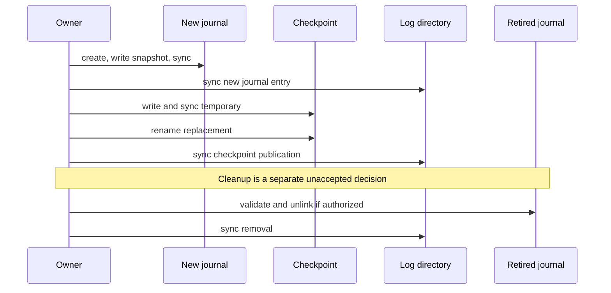
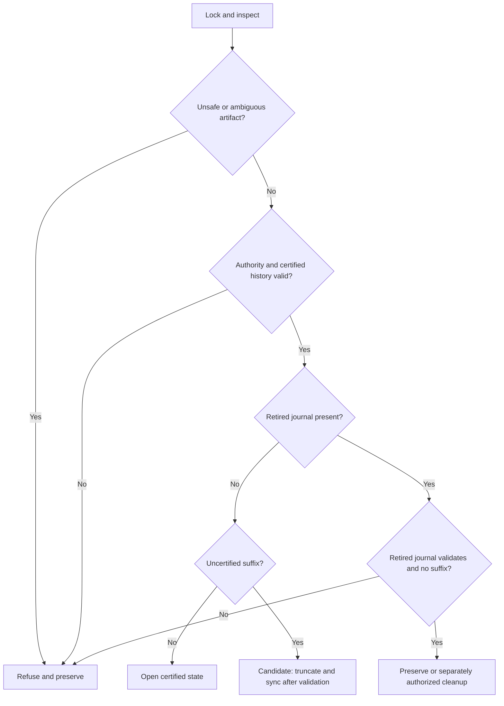

# ADR-024: candidate journal rotation with explicit retirement

Status: **PROPOSED FOR REVIEW; not accepted and not implementation authority.**
This extends the working journal candidate in
[the journal packet](ADR-024-metadata-journal-decision-packet.md). The founder
selected a journal direction, not these bytes or a cleanup protocol. Preserve
sync-before-ACK, full certified-payload verification, absolute offsets, no
implicit event retention, and evidence on ambiguous recovery. An operator or
external process can still restore a coherent older checkpoint and files; no
local identity, generation or CRC establishes freshness or fences a writer.

## Design choice under review

Consider a checkpoint that explicitly names **one** retired journal and binds
its certified content to the new epoch's initial snapshot. Unlike the earlier
64-byte example, the candidate below is 96 bytes. A named retirement is not
permission to delete arbitrary journal-looking files. Cleanup here concerns
metadata journal files only, never retained event segment files. Permit at most
one explicitly named retired file; a new rotation must first complete its
cleanup or refuse. An orphan, unexpected name, failed validation or ambiguous
file type is preserved and causes refusal.

This candidate deliberately evaluates automatic removal of a *specifically
identified, validated and durably retired metadata file*. Such removal is a
separate persistent recovery decision and requires explicit acceptance; the
existing preservation rule still applies to ambiguous crash artifacts. An
alternative is operator quarantine with the same binding and a separate
procedure; it increases operational intervention. Neither approach is accepted.
CRC-32C detects accidental errors and is not a cryptographic identity or proof
against a malicious writer. A review must consider CRC collisions, identity
reuse and the trusted/cooperating-process assumptions before selecting this
binding; a stronger digest requires separate dependency and format review.

## Candidate checkpoint v1-R bytes

Exactly 96 bytes, all integers big-endian, checksummed and bounded before use:

| Bytes | Field |
| --- | --- |
| 0..4 | ASCII `SRJC` |
| 4 | version **2**, distinct from the earlier 64-byte candidate |
| 5..8 | zero reserved |
| 8..24 | nonzero 128-bit log identity |
| 24..32 | active journal epoch u64 |
| 32..40 | active certified journal byte length u64 |
| 40..48 | last certified journal record sequence u64 |
| 48..56 | next absolute offset u64, checked against reconstructed state |
| 56..60 | retirement flag u32: 0 = none, 1 = one retired journal |
| 60..68 | retired epoch u64, zero if flag 0 |
| 68..76 | retired certified journal length u64, zero if flag 0 |
| 76..84 | retired last certified sequence u64, zero if flag 0 |
| 84..88 | CRC-32C of the retired journal's entire certified byte range; zero if flag 0 |
| 88..92 | zero reserved |
| 92..96 | CRC-32C of checkpoint bytes 0..92 |

Reject unknown flags, unsupported versions, nonzero reserved fields, bad CRC,
arithmetic overflow and impossible lengths. When flag is 1, active epoch must
equal retired epoch + 1 with checked arithmetic; retired length includes the
journal header and is bounded by 16 MiB. The active journal snapshot sequence
must equal retired sequence + 1; subsequent records increment sequentially and
must end at checkpoint last sequence. The new snapshot's reconstructed offset
and segment entries must equal the old journal's certified reconstructed state
when the retired file exists. Verify every referenced segment's certified
payload independently, including sealed segments. A version-1 64-byte
checkpoint is a preliminary vector only, not an approved old on-disk format;
do not treat this proposal as an automatic v1-to-v2 migration.

Preliminary empty-state rotation vectors below use identity
`00112233445566778899aabbccddeeff`, old epoch/sequence 0, new epoch/sequence 1
and one empty active segment. They were computed with a standalone bitwise
CRC-32C implementation; they are review examples, not accepted golden fixtures
or evidence of a safe rotation.

```text
old journal (112 bytes): 53524a310100000000112233445566778899aabbccddeeff0000000000000000000000286b9ac0e353524a520101000000000048000000000000000000000028ae847cf80e26b8a600000000000000000000000100000000000000000000000000000000000000000000000000000000
new journal (112 bytes): 53524a310100000000112233445566778899aabbccddeeff000000000000000100000028538baf4f53524a520101000000000048000000000000000100000028ae847cf8fa186eee00000000000000000000000100000000000000000000000000000000000000000000000000000000
checkpoint (96 bytes): 53524a430200000000112233445566778899aabbccddeeff00000000000000010000000000000070000000000000000100000000000000000000000100000000000000000000000000000070000000000000000016962b470000000042a11fff
initial checkpoint (96 bytes): 53524a430200000000112233445566778899aabbccddeeff000000000000000000000000000000700000000000000000000000000000000000000000000000000000000000000000000000000000000000000000000000000000000054d195b2
```

The existing Rust review test checks these documented bytes and CRCs with the
project CRC library. It was written alongside the proposal, does not exercise
the filesystem or failure boundaries, and is not independent protocol review.

With flag 0 no retired file is allowed. With flag 1, the retired file may be
absent **only as the defined post-cleanup state**; the active checkpoint and
all active journal and certified segment bytes must still validate. If present,
open without following links, require singly linked regular file, matching log
identity/epoch and exact physical length, verify its full-file CRC, all its
record checksums and reconstructed state against the active epoch's first
snapshot. A mismatched, short, long, unreadable or corrupt retired file is
preserved and causes refusal. The checkpoint does not store an independent
attestation that cleanup happened; absence cannot establish freshness, detect a
coherent rollback, or prove why the old file is absent. A loss of a retired
file is not itself accepted as permission to accept an invalid active state.

## Proposed transition

The following illustrates the candidate ordering, not a verified protocol:



1. Under the directory and lock-file locks, verify active authority and state,
   including all certified journal records and segment frames. Require no
   unexpected artifacts or uncertified suffixes. If the checkpoint already
   names a retired file, perform the reviewed cleanup below or refuse before
   creating another journal. Check the next epoch, sequence, snapshot size and
   capacity before mutation.
   If a validated checkpoint names a retired file that is already absent and
   no other artifact is unexplained, the candidate treats that as its defined
   post-cleanup state: no unlink is needed. Before a new rotation, sync the
   current checkpoint file and containing directory; if either fails, refuse.
   Absence does not prove who removed the file or detect external rollback.
2. Exclusively create the next epoch file and write its header plus one snapshot
   of the complete current certified segment state. Its first sequence is the
   old last sequence + 1. Sync the new file, then sync the directory entry.
   Retain the old journal unchanged. Any error latches terminal and preserves
   artifacts; an extra new journal under an old checkpoint is ambiguous.
3. Write a version-2 checkpoint temporary naming the new journal and its exact
   certified snapshot, binding the old epoch, certified length, last sequence
   and full certified-range CRC. Sync it, rename over the authority and sync the
   directory. No group may be acknowledged on the new journal before this
   barrier. If rename or directory sync fails, its outcome is unknown.
4. Only after the new authority is durable, validate the named retired journal
   as above and, if the separately accepted cleanup protocol is enabled, unlink
   that exact file and sync the containing directory. Recheck identity while
   holding cooperative locks. If a no-follow identity-safe unlink cannot be
   justified on a platform under the documented threat model, refuse cleanup.
   Any error latches terminal. Resume writes only after the cleanup and directory
   sync succeed, or after a fresh recovery classifies a missing retired file.
   Do not clear the retired fields merely because the unlink succeeded; the
   checkpoint keeps the same binding on subsequent commits until another
   rotation publishes a replacement binding. This avoids an extra publication
   whose crash states would otherwise also need classification.

On restart, even if a new checkpoint and retired file are visible, the process
cannot infer that the previous directory sync returned success. Before any
cleanup mutation, first validate the new authority, sync its file and directory,
and confirm both succeed. This establishes the new barrier under the stated
filesystem assumptions before unlinking a file; visibility alone is not proof
that an earlier barrier completed. Unexpected temporary files, extra epochs or
segment files, missing certified data, or conflicting retirement bindings refuse
and preserve all artifacts. This procedure does not repair uncertain appends.

## Crash-state classification to test

| State observed under locks | Candidate behavior |
| --- | --- |
| Old authority, no new file or temp | Validate old certified history; continue or retry rotation. |
| Old authority plus new epoch file or temporary checkpoint | Refuse and preserve both, even if new file is complete and valid. |
| New authority names active and retired files, both validate, no other artifacts | Re-sync active authority and directory; only then consider separately authorized retired-file cleanup. |
| New authority, active valid, retired file absent | Validate all active certified history; proceed as post-cleanup state. No conclusion about external rollback or how the file disappeared. |
| New authority with retired file present but mismatched, corrupted or wrong type | Refuse and preserve; no removal based on name alone. |
| Any authority plus unexpected epoch, temp, missing active journal or segment, or corrupt certified range | Refuse and preserve; apply no cleanup. |
| Crash/failure during unlink or directory sync after it | On restart apply the present/absent rows above. The durable new authority must remain sufficient for all previously acknowledged offsets. |

Cases combine with pre-existing checkpoint-temp and active-tail rules; earlier
ambiguity/refusal wins over cleanup. A healthy log can remain unavailable after
an interrupted pre-publication rotation because an unreferenced new epoch is
preserved. That availability cost and an operator path are explicit release
decisions. A coherent restored old authority plus old data remains indistinguishable
from a legitimate earlier state.

### Candidate opening decision order

This is a review oracle specification, not implemented recovery. Acquire the
directory lock before examining entries; for an existing directory acquire its
existing lock-file lock before recovery. For an empty directory only, initialize
under the separate creation protocol. Apply the first matching condition; no
cleanup or truncation occurs during classification. Row 11 describes a
separately authorized recovery action after classification and verification.



The diagram summarizes the journal branch only; the ordered table below governs
legacy dispatch, initialization, missing retired files and precedence.

| Priority | Observation | Required candidate result |
| --- | --- | --- |
| 1 | Open, enumeration or required lock fails; layout cannot be identified | Refuse, preserving artifacts; an I/O failure alone is not proof of corruption. |
| 2 | Genuinely empty directory | Initialize only under the reviewed initialization protocol; loss of former contents is outside local rollback detection. |
| 3 | Nonempty directory with missing/unsafe lock, symlink, nonregular or multiply linked storage entry, unknown name or mixed layouts | Refuse and preserve. A quarantine-looking filename has no special authority. |
| 4 | Recognized legacy single-segment layout only | Dispatch to existing legacy rules, without implicit migration or new-format cleanup. |
| 5 | Missing, malformed, unsupported, unreadable, bad-checksum or invariant-violating candidate checkpoint | Refuse and preserve all files. The old 64-byte sketch is not an accepted candidate checkpoint. |
| 6 | Any temporary checkpoint, regardless of content, generation or apparent validity | Refuse and preserve, even if all other files are valid. |
| 7 | Missing active journal, extra unbound epoch or segment, missing referenced segment, or any unexplained artifact | Refuse and preserve. An old checkpoint plus a new epoch is an orphan case. |
| 8 | Invalid certified journal header or record, short certified file, sequence or checkpoint mismatch, invalid snapshot or certified segment frame, sealed length mismatch | Refuse and preserve; never truncate a suffix before all certified history validates. |
| 9 | Checkpoint retirement binding present and named retired file exists but has wrong identity, length, fingerprint, records, sequence or reconstructed state | Refuse and preserve; do not clean up based on filename. |
| 10 | All certified state validates; no unexpected artifacts; no suffixes; retired file absent or no retirement binding | Open at certified boundary. A missing named retired file is allowed only by the proposed retirement rule and does not detect external rollback. |
| 11 | As row 10, but active journal and/or active segment has an uncertified suffix | After verifying all certified history, truncate and sync the journal suffix first, then the active segment suffix. Any failure refuses; a completed first truncation or failed truncation may already have changed an uncertified suffix. |
| 12 | All certified state validates and exactly the bound retired journal exists | Preserve it unless the separately accepted cleanup protocol is enabled. Before cleanup re-sync active authority and directory, then validate and unlink only the named bound file and sync directory. Failure refuses and may have an unknown unlink outcome. |

Rows 10–12 are proposals, not proof that an unacknowledged operation did or did
not persist. A returned ACK follows the complete barrier; a returned error after
publication starts can be unknown. A present retired journal plus an active
suffix requires both validation and separately reviewed ordering of cleanup
versus suffix truncation: **refuse without mutation until that ordering is
decided**. Likewise, a missing retired journal is accepted only under the
proposed checkpoint retirement semantics; it is not evidence of an external
backup, successful earlier cleanup or absence of rollback. Rows 10–12 are
mutually exclusive after these qualifications.

Required deterministic cases include each row and collisions: bad authority
plus temp, temp plus orphan, old checkpoint plus fully synced new journal,
new checkpoint plus retired file, missing active data plus suffix, early sealed
corruption plus suffix, malformed retired file plus valid snapshot, valid
retired file plus suffix, and failures before/after every truncation, unlink,
file sync, directory sync and rename. A final error after mutation may leave
only uncertified suffixes or the explicitly retired file changed; no test may
claim a failed syscall implies no mutation. Explicitly compare all preexisting
certified bytes and acknowledged offsets across each modeled restart.

## Required review and evidence

- Independently review whether the full prior-state reconstruction and CRC
  binding are sufficient under the exact corruption model; no assumed property
  of RocksDB or LevelDB proves it. Review supported filesystems, no-follow and
  link/rename/unlink races under the existing cooperative threat model.
- Produce independently generated 96-byte checkpoint and multi-epoch complete
  fixture vectors, malformed/future-version and mismatch examples, a separate
  verifier and actual old-reader refusal tests. The 64-byte preliminary vectors
  do not validate this layout.
- Run deterministic before/after and error injection for every write, file sync,
  directory sync, rename, validation and unlink, including old/new authority
  outcomes and interrupted suffix truncation. Test missing and extra files,
  mismatched epoch/identity/CRC/state, u64 exhaustion and repeated restarts.
  Verify no acknowledged segment bytes are lost, no uncertified data is returned,
  and ambiguous artifacts are not deleted.
- Separately perform process-crash tests and ext4/XFS block/VM power-loss replay
  against an authorized implementation. Test sync and unlink failure on each
  supported platform; no-replace and directory-sync behavior must not be
  assumed from API availability. Prior G1 replay is not evidence for this format.
- Compare this candidate against the single-manifest and small-checkpoint
  alternatives with matched sync-before-ACK settings, including journal rotation
  tail latency, memory and full-history startup. No performance claim is made.

### Review artifacts and their limits

[The generator](../../scripts/adr024-journal-fixtures.py) creates a two-segment,
two-epoch example with real pre-existing event frames, prior-epoch snapshot,
append, roll and append records, and a new-epoch snapshot/checkpoint. It also
generates post-cleanup, orphan, temporary, missing-file, truncated, checksum,
retired-corruption and dual-suffix examples. Preserved [fixture directories](../verification/adr024-journal-fixtures)
and their [SHA-256 inventory](../verification/adr024-journal-fixtures.sha256)
are review artifacts. The generator is a standalone bitwise CRC implementation,
not production or migration code; event frames are reused from the earlier
fixture corpus. This example is constructed directly, not produced by actual
rotation or migration.

The separately written [Rust fixture test](../../tests/adr024_journal_fixture_review.rs)
uses the project's CRC library to check the candidate checkpoint and active
snapshot framing for this fixture family, replays the old multi-record journal,
compares its reconstructed state to the new snapshot, checks segment and retired
file checksums, and attempts to open all directories using the old-format reader
while comparing names and bytes. The verifier is deliberately limited: it is
not a general journal parser, does not check all record and directory semantics,
does not prove that fixture files meet this entire specification, and does not
simulate recovery or crashes. A separately compiled
test using the archived `c5617d3` storage source passed locally on macOS; it
does not check every metadata field or other platforms.

Run the fixture check on disposable generated copies:

```sh
python3 scripts/adr024-journal-fixtures.py /tmp/adr024-journal-review
python3 scripts/adr024-journal-fixtures.py --verify /tmp/adr024-journal-review
ADR024_JOURNAL_FIXTURES=/tmp/adr024-journal-review cargo test --locked --test adr024_journal_fixture_review -- --ignored
python3 scripts/adr024-journal-recovery-oracle.py
```

The generator refuses to overwrite an existing path. The separate
[classification model](../../scripts/adr024-journal-recovery-oracle.py)
exercises 12 abstract decisions and selected collisions; it does not inspect
files or model actual syncs, crashes or system-call failures. Its rules were
written alongside this proposal, not independently reviewed. Full fixtures,
independent protocol review and implementation-level fault tests remain open.

### Operational cost and cleanup alternatives

An initial empty 16 MiB journal fits about 233,015 72-byte append records, less
when other records occur. Rotation leaves a bound retired file. Under the
candidate's current step 4, if automatic cleanup has not been separately
accepted and the file remains present, **writes stop at the first rotation**;
it is not safe to promise a second full journal's worth of progress. An
interrupted pre-publication rotation can also stop the partition on its first
occurrence. Any intervention is separately reviewed and authorized.

While the retired file remains, a restart must verify its entire certified
range and records as well as the active journal, up to 16 MiB each under the
candidate bounds, in addition to full historical event-payload verification.
Include this worst case, no-retired case and rotation/cleanup tails in matched
startup and latency measurements.

An alternative is an additional checkpoint publication after cleanup that
records an explicit `retired-and-cleaned` state. This may simplify later state
interpretation but creates another file-sync/rename/directory-sync boundary
and failure matrix; it needs precise bytes and correctness review. Neither an
explicit flag nor a missing file proves that an external rollback or
uncooperative deletion did not occur. The current candidate keeps the binding
until the next rotation; this trade-off is open, not an accepted decision.

The user must accept exact format, retirement behavior and recovery semantics
before implementation. No operator mutation, retention, coordinator or G1 gate
is accepted by this proposal.
